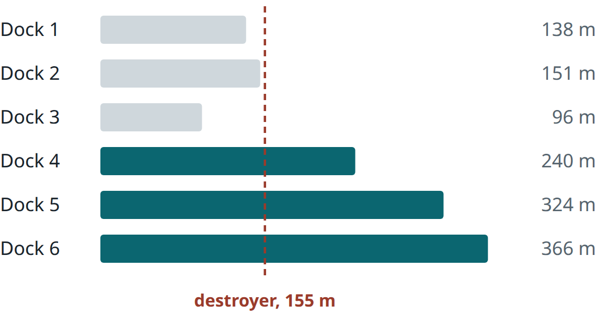

The Navy's own April plan puts six of its 11 carriers in a yard period at once from January to March 2028, three of them on Puget Sound Naval Shipyard's crews, and that was written before the war with Iran stretched deployments. The two Japan-based destroyers wrecked in 2017 collisions each took about two years to repair, and a war game by the RAND Corporation had several damaged at once, inside the range of China's missiles. Printed parts are getting cheaper to prove, but makers still own the drawings for some Virginia-class parts. And seven dated items, from the first 11-month destroyers coming home to a deferred-maintenance report Congress was owed on Oct. 15.

How to read this: where a sentence names where something came from, those words are a link to
the source itself, and the sentence says what that source says. A sentence with no link is this
desk's analysis, built only on the linked facts above it. Two warnings are still written out in
the text: Speculation, and Unverified for a claim nobody here could check against a primary
source, with the reason it could not be checked.

> **[Download the print edition (PDF)](pdf/2026-w44.225986d5.pdf)**: three two-column article pages, the
> watch list and a page of dated events.

## Operations Maintenance & Readiness

### The Navy's plan puts six of 11 carriers in yards in early 2028, three on one shipyard's crews

The Navy's April budget sets each carrier's planned maintenance dates, and the war with Iran now has to fit inside that plan. Every date below is the Navy's plan as of April. [Adm. James Kilby, the Navy's vice chief, told the National Commission on the Future of the Navy on Oct. 8](https://www.militarytimes.com/news/your-military/2026/10/08/readiness-bill-coming-due-for-navy-after-marathon-carrier-deployment-no-2-admiral-says/) that readiness is "artificially high" because ships have not yet returned to maintenance. He said the Navy must get better at showing "what the cost of this extension will be two years from now." He named two ways to pay: "we'll have to sequence that," or "squish the package into the bare minimum and not do modernization things I need to do."

The plan peaks within those two years. [The Navy's April budget book](https://web.archive.org/web/20260927025227/https://www.secnav.navy.mil/fmc/fmb/Documents/27pres/OMN_Book.pdf) starts yard periods for Vinson on Jan. 7, 2028, George Washington on Jan. 12 and Eisenhower on Jan. 19, while Roosevelt's runs to March 7. Truman stays in its refueling overhaul [to 2031](https://web.archive.org/web/20261007124109/https://www.secnav.navy.mil/fmc/fmb/Documents/27pres/SCN_Book.pdf), and Stennis in its until April 2028, five months later than [the previous budget](https://web.archive.org/web/20260903083216/https://www.secnav.navy.mil/fmc/fmb/Documents/26pres/SCN_Book.pdf) said. Nimitz leaves fleet tasking in March 2027, the month [the Navy told The War Zone](https://www.twz.com/sea/navy-juggles-its-aircraft-carrier-plans-to-stay-afloat) the new Kennedy delivers, and [The War Zone counted three carriers in maintenance on Oct. 17](https://www.twz.com/sea/where-are-the-aircraft-carriers-october-17-2026).

By our count, six of the 11 carriers are in a yard period at once from Jan. 19 to March 7, 2028, double today's three. On the previous budget's Stennis date it would be five.

*Carriers of 11 in a scheduled yard period, by month, from the dates in the Navy's April 2026 budget book (a carrier counts for any part of the month). Light block: Lincoln, if its Bremerton docking runs 17 to 18 months from January 2027, our assumption. Ford, at Norfolk with no stated end date, is not counted.*

Much of the load lands on one shipyard's workforce. In the book, Puget Sound Naval Shipyard carries public-yard work on three of those carriers from Jan. 12 to March 7, 2028: Vinson at Bremerton, Roosevelt alongside a private period in San Diego, and George Washington in Yokosuka.

Lincoln could make it four. It came home Oct. 8 after 321 days, many in the war against Iran, [The War Zone reported](https://www.twz.com/sea/where-are-the-aircraft-carriers-october-17-2026), and [the Navy said Oct. 19](https://www.navy.mil/Press-Office/News-Stories/display-news/Article/4628279/uss-abraham-lincoln-to-shift-home-port-to-bremerton/) it moves to Bremerton "later this year" for maintenance, with [no start date](https://www.stripes.com/branches/navy/2026-10-19/uss-abraham-lincoln-homeport-kitsap-23199798.html). The budget book calls it a docking. Reagan's there took [18 months, Stars and Stripes reported](https://www.stripes.com/branches/navy/2026-09-15/uss-ronald-reagan-rejoins-fleet-22863878.html), but Reagan had not docked since 2012, so it may overstate Lincoln's.

The plan assumes deployed ships return on time. Bush, deployed since March 31, is back in the Middle East with George Washington, [The War Zone reported Oct. 17](https://www.twz.com/sea/where-are-the-aircraft-carriers-october-17-2026). The budget book starts Bush's pierside period on Nov. 22 and George Washington's Yokosuka period on Jan. 13, 2027, and ends Bush's next period Dec. 25, 2027.

Recent periods vary. Eisenhower spent [about 15 months at Norfolk](https://www.navy.mil/Press-Office/News-Stories/display-news/Article/4028611/uss-dwight-d-eisenhower-transits-to-norfolk-naval-shipyard-nnsy-for-a-planned-i/), which [the shipyard called](https://www.dvidshub.net/news/563538/uss-dwight-d-eisenhower-completes-planned-incremental-availability-norfolk-naval-shipyard) an "early completion." [The War Zone reported](https://www.twz.com/sea/navy-juggles-its-aircraft-carrier-plans-to-stay-afloat) the fiscal 2026 budget had it done in July 2025. Vinson took [about seven months at North Island](https://www.dvidshub.net/news/568980/uss-carl-vinson-completes-planned-incremental-availability). Bush's last period took about a year, [USNI News reported](https://news.usni.org/2026/07/14/carrier-uss-gerald-r-ford-starts-first-major-post-deployment-maintenance-period), and Ford, at Norfolk since July, has no stated end. Eisenhower, the second-oldest carrier, also overran in 2018, [which the Navy blamed on age](https://news.usni.org/?p=36749). [The April book](https://web.archive.org/web/20260927025227/https://www.secnav.navy.mil/fmc/fmb/Documents/27pres/OMN_Book.pdf) schedules its inactivation for fiscal 2030, about 16 months after its 2028 period ends.

We expect the next budget book to move Vinson's or, likelier, Eisenhower's January 2028 start, or to trim Eisenhower's package, the ship nearest retirement. We expect Lincoln's docking to run shorter than Reagan's 18 months, because Reagan's carried a decade of saved-up dock work, but long enough to overlap the January peak, as the chart's light block assumes. If Bush stays deployed into spring, its next period moves, and a finish past the book's Dec. 25 end puts a seventh carrier into January 2028. We are wrong if the next book keeps both January starts and Eisenhower's full package, or if Lincoln's docking runs 18 months or more.

**Bottom line:** In early 2028, the carriers ready to deploy are Reagan, back from its docking since September, Ford once its Norfolk period ends, Kennedy only months past delivery, and Bush only if its next period ends on time. Work that counts on borrowing Puget Sound Naval Shipyard's people, planners or long-lead material in that window is safer scheduled around it now.

*Sources: [Military Times, Oct. 8, 2026](https://www.militarytimes.com/news/your-military/2026/10/08/readiness-bill-coming-due-for-navy-after-marathon-carrier-deployment-no-2-admiral-says/); [Navy FY2027 OMN budget book](https://web.archive.org/web/20260927025227/https://www.secnav.navy.mil/fmc/fmb/Documents/27pres/OMN_Book.pdf); [Navy FY2027 SCN budget book](https://web.archive.org/web/20261007124109/https://www.secnav.navy.mil/fmc/fmb/Documents/27pres/SCN_Book.pdf) and [FY2026 SCN book](https://web.archive.org/web/20260903083216/https://www.secnav.navy.mil/fmc/fmb/Documents/26pres/SCN_Book.pdf); [The War Zone, March 17](https://www.twz.com/sea/navy-juggles-its-aircraft-carrier-plans-to-stay-afloat), [Oct. 17](https://www.twz.com/sea/where-are-the-aircraft-carriers-october-17-2026); [U.S. Navy, Oct. 19](https://www.navy.mil/Press-Office/News-Stories/display-news/Article/4628279/uss-abraham-lincoln-to-shift-home-port-to-bremerton/); [Stars and Stripes, Oct. 19](https://www.stripes.com/branches/navy/2026-10-19/uss-abraham-lincoln-homeport-kitsap-23199798.html), [Sept. 15](https://www.stripes.com/branches/navy/2026-09-15/uss-ronald-reagan-rejoins-fleet-22863878.html); [U.S. Navy, Jan. 14, 2025](https://www.navy.mil/Press-Office/News-Stories/display-news/Article/4028611/uss-dwight-d-eisenhower-transits-to-norfolk-naval-shipyard-nnsy-for-a-planned-i/); [DVIDS, April 24](https://www.dvidshub.net/news/563538/uss-dwight-d-eisenhower-completes-planned-incremental-availability-norfolk-naval-shipyard), [June 30](https://www.dvidshub.net/news/568980/uss-carl-vinson-completes-planned-incremental-availability); [USNI News, July 14](https://news.usni.org/2026/07/14/carrier-uss-gerald-r-ford-starts-first-major-post-deployment-maintenance-period); [USNI News, Sept. 24, 2018](https://news.usni.org/?p=36749).*

### Two 2017 destroyer repairs took about two years each; RAND's war game damaged several at once

The two Japan-based destroyers badly damaged in 2017 collisions were each out of the fleet about two years, one repaired in Yokosuka and one shipped home. A Pacific war would need faster work on more ships: [RAND's war game](https://www.defensenews.com/news/pentagon-congress/2026/06/22/us-couldnt-repair-battle-damaged-ships-in-war-with-china-study-finds/) had several destroyers badly damaged at once.

McCain was the forward case. [The Maritime Executive reported in late 2018](https://maritime-executive.com/article/uss-mccain-exits-drydock-after-collision-repairs) that after its Aug. 21, 2017 collision near Singapore, the Navy "decided to repair the McCain in Yokosuka rather than incurring the additional time and expense of shipping her back," and that the ship spent nine months in dry dock. [Defense Daily reported](https://defensedaily.com/uss-mccain-back-sea-finishing-repairs/navy-usmc) that McCain went to sea for trials on Oct. 27, 2019, after "nearly two years of necessary repairs in Japan." Fitzgerald, [barged to Mississippi](https://news.usni.org/2020/02/03/uss-fitzgerald-returns-to-sea-after-repairs-caused-by-fatal-2017-collision), left for sea trials "After more than two years of repairs."

Japan's base is large and old. [Naval Sea Systems Command (NAVSEA) says](https://www.navsea.navy.mil/Home/RMC/SRF-JRMC/About-Us/Our-History/) Yokosuka has had Japanese workers since 1947 and "six dry docks with a combined displacement of 530,000 tons," and [Sasebo has one](https://www.navsea.navy.mil/Home/RMC/SRFJRMC/JapanTours/WorkingInJapan/SRFJRMCSaseboOperations/). Together they support ["the 23 forward-deployed ships based in Yokosuka and Sasebo,"](https://www.dvidshub.net/news/490220/srf-jrmc-hosts-change-command) by a 2025 Navy count. (This Defense Visual Information Distribution Service (DVIDS) page is quoted from a saved copy and was not rechecked this pass.)

Only three of Yokosuka's six docks are long enough for a destroyer. Docks 1 to 3, opened from 1871 to 1884, run 96 to 151 meters, [by the figures in Japanese records](https://ja.wikipedia.org/wiki/%E6%A8%AA%E9%A0%88%E8%B3%80%E6%B5%B7%E8%BB%8D%E6%96%BD%E8%A8%AD%E3%83%89%E3%83%83%E3%82%AF) (compiled from Yokosuka City and University of Tokyo surveys), and an Arleigh Burke-class destroyer is [154 to 155 meters long](https://en.wikipedia.org/wiki/Arleigh_Burke-class_destroyer). Docks 4, 5 and 6 run 240 to 366 meters. Fitzgerald sat in Dock 5 in 2016, [U.S. Naval Forces Japan posted](https://x.com/CNFJ/status/753500729961287680).

*Yokosuka's six dry docks by length, against an Arleigh Burke-class destroyer. Filled bars are long enough. Length only; entrance width and depth also limit a dock.*

So three destroyers needing McCain-scale work at once would fill all three Yokosuka docks that fit one for most of a year. Dock length is only the first limit; entrance width, sill depth and blocking also count, and no public record gives them. No public record says how many battle-damaged ships the forward sites could take at once.

The next case would not come alone. [RAND reported in May](https://www.rand.org/pubs/research_reports/RRA470-9.html) that a war in the Indo-Pacific "would give rise to the greatest demand for ship repair that the Navy has experienced since World War II." [Defense News reported](https://www.defensenews.com/news/pentagon-congress/2026/06/22/us-couldnt-repair-battle-damaged-ships-in-war-with-china-study-finds/) that the study found "U.S. maintenance facilities would be overwhelmed" and recommends "scalable Expeditionary Mobile Repair Facilities." Bradley Martin, a co-author, told the paper that Japan, Korea and Australia "are in principle committed to supporting U.S. repair, but this cannot be assumed once the threat level starts to escalate."

And the forward sites are targets. In 2021 the Government Accountability Office (GAO) warned, [Defense News reported](https://www.defensenews.com/news/your-navy/2021/06/08/is-the-navy-ready-to-repair-battle-damaged-ships-in-wartime/), that repair sites in a combat zone could themselves come under attack. [Task & Purpose reported in September](https://taskandpurpose.com/news/navy-base-bahrain-iran-damage/) that the acting Navy Secretary said "They blew the hell out of Bahrain," and the Chief of Naval Operations said the Navy is "not getting back in [the base in Bahrain] anytime soon." (Quoted from a saved copy, not rechecked this pass.) The base housed a repair detachment that, by [NAVSEA's undated page](https://www.navsea.navy.mil/Home/RMC/FDRMC/Bahrain/WorkingInBahrain/FDRMCBahrain/), maintained 14 forward-deployed ships. With the base out, [Reuters reported in March](https://www.arabnews.com/node/2637617/amp) that two Bahrain-based littoral combat ships were in maintenance in Singapore, 6,300 km away, and a US official said the Navy had "not a lot of options" in the Indian Ocean to maintain them.

The Japan and Philippine sites sit inside China's anti-ship missile range. [The Pentagon's 2024 China report](https://media.defense.gov/2024/Dec/18/2003615520/-1/-1/0/MILITARY-AND-SECURITY-DEVELOPMENTS-INVOLVING-THE-PEOPLES-REPUBLIC-OF-CHINA-2024.PDF) says the DF-21D has "a range exceeding 1,500 km," and [its 2025 report](https://media.defense.gov/2025/Dec/23/2003849070/-1/-1/1/ANNUAL-REPORT-TO-CONGRESS-MILITARY-AND-SECURITY-DEVELOPMENTS-INVOLVING-THE-PEOPLES-REPUBLIC-OF-CHINA-2025.PDF) lists the DF-26 at 3,000 to 4,000 km for land attack and anti-ship strikes. By our measurement from the nearest point of China's coast, Sasebo is about 770 km away, Subic Bay 1,020, Maizuru 1,100, Hakodate 1,410 and Yokosuka 1,455, all inside the DF-21D's stated range. Singapore (2,200 km) and Guam (2,920 km) are beyond it but inside the DF-26's. Only Darwin and Stirling, in Australia, lie beyond both. [RAND's study found](https://www.rand.org/pubs/research_reports/RRA470-9.html) that partner nations "would be directly vulnerable to attack were they to host U.S. ships for extended periods."

*Our measurement: straight-line distance from the nearest point on China's mainland coast to each repair site, against the ranges in the Pentagon's 2024 and 2025 China reports (DF-21D "exceeding 1,500 km"; DF-26 3,000 to 4,000 km, upper figure shown). Red: inside DF-21D range. Amber: inside DF-26 only. Launchers sit inland, so real distances differ.*

The Navy is rehearsing in partner ports and moving dockings forward. [7th Fleet reported](https://www.cpf.navy.mil/Newsroom/News/Article/4618470/uss-warrior-completes-ship-repair-and-maintenance-exercise-in-hakodate/) that USS Warrior worked with Japanese repair workers in Hakodate and ran "a battle damage assessment and repair table-top exercise," the second such drill in Japan, with others run in Australia, the Philippines and Singapore. In Spain, [USS Arleigh Burke entered dry dock](https://www.navy.mil/Press-Office/News-Stories/display-news/Article/4622364/uss-arleigh-burke-enters-dry-dock-in-spain-expanding-the-us-navys-forward-deplo/) at Navantia's Cadiz yard, which the Navy called the first docking in the 6th Fleet area since the Rota destroyers arrived; [in 2019, two of them were slated](https://www.navytimes.com/news/your-navy/2019/06/07/what-you-need-to-know-about-the-upcoming-homeport-shifts/) to "return to Norfolk for overhauls."

Congress has asked for the count. [The joint explanatory statement on the fiscal 2026 defense authorization act](https://armedservices.house.gov/uploadedfiles/fy26_ndaa_joint_explanatory_statement.pdf) directs the Navy to report by Dec. 1, 2026 on the capacity of US public and private yards, and of allied and partner yards in the Indo-Pacific, to support "battle damage repair," including their workforce and supply chains. The directive is report language, not law, and the report goes to the defense committees, so it may never be public.

On that arithmetic the US Navy's docks in Japan could not take more than three McCain-scale repairs at once, one in each dock long enough, so partner yards and RAND's mobile repair would have to. We expect the drills to spread to more Japanese commercial yards, the pattern Hakodate set. This reading is wrong if, by the end of 2027, the battle damage part is still a tabletop exercise, or no Japan-based or damaged combatant has docked in a partner yard.

**Bottom line:** Forward repair runs from Japan to Spain, and heavy damage still took about two years at Yokosuka or at home. In any plan that assumes wartime repair in Japan, count three destroyer-length docks at Yokosuka, each held most of a year by a McCain-scale job, and send the rest of the damaged ships to partner yards and mobile repair that so far exist only in drills.

*Sources: [RAND's war game](https://www.defensenews.com/news/pentagon-congress/2026/06/22/us-couldnt-repair-battle-damaged-ships-in-war-with-china-study-finds/); [The Maritime Executive reported in late 2018](https://maritime-executive.com/article/uss-mccain-exits-drydock-after-collision-repairs); [Defense Daily reported](https://defensedaily.com/uss-mccain-back-sea-finishing-repairs/navy-usmc); [barged to Mississippi](https://news.usni.org/2020/02/03/uss-fitzgerald-returns-to-sea-after-repairs-caused-by-fatal-2017-collision); [Naval Sea Systems Command (NAVSEA) says](https://www.navsea.navy.mil/Home/RMC/SRF-JRMC/About-Us/Our-History/); [Sasebo has one](https://www.navsea.navy.mil/Home/RMC/SRFJRMC/JapanTours/WorkingInJapan/SRFJRMCSaseboOperations/); ["the 23 forward-deployed ships based in Yokosuka and Sasebo,"](https://www.dvidshub.net/news/490220/srf-jrmc-hosts-change-command); [by the figures in Japanese records](https://ja.wikipedia.org/wiki/%E6%A8%AA%E9%A0%88%E8%B3%80%E6%B5%B7%E8%BB%8D%E6%96%BD%E8%A8%AD%E3%83%89%E3%83%83%E3%82%AF); [154 to 155 meters long](https://en.wikipedia.org/wiki/Arleigh_Burke-class_destroyer); [U.S. Naval Forces Japan posted](https://x.com/CNFJ/status/753500729961287680); [RAND reported in May](https://www.rand.org/pubs/research_reports/RRA470-9.html); [Defense News reported](https://www.defensenews.com/news/your-navy/2021/06/08/is-the-navy-ready-to-repair-battle-damaged-ships-in-wartime/); [Task & Purpose reported in September](https://taskandpurpose.com/news/navy-base-bahrain-iran-damage/); [NAVSEA's undated page](https://www.navsea.navy.mil/Home/RMC/FDRMC/Bahrain/WorkingInBahrain/FDRMCBahrain/); [Reuters reported in March](https://www.arabnews.com/node/2637617/amp); [The Pentagon's 2024 China report](https://media.defense.gov/2024/Dec/18/2003615520/-1/-1/0/MILITARY-AND-SECURITY-DEVELOPMENTS-INVOLVING-THE-PEOPLES-REPUBLIC-OF-CHINA-2024.PDF); [its 2025 report](https://media.defense.gov/2025/Dec/23/2003849070/-1/-1/1/ANNUAL-REPORT-TO-CONGRESS-MILITARY-AND-SECURITY-DEVELOPMENTS-INVOLVING-THE-PEOPLES-REPUBLIC-OF-CHINA-2025.PDF); [7th Fleet reported](https://www.cpf.navy.mil/Newsroom/News/Article/4618470/uss-warrior-completes-ship-repair-and-maintenance-exercise-in-hakodate/); [USS Arleigh Burke entered dry dock](https://www.navy.mil/Press-Office/News-Stories/display-news/Article/4622364/uss-arleigh-burke-enters-dry-dock-in-spain-expanding-the-us-navys-forward-deplo/); [in 2019, two of them were slated](https://www.navytimes.com/news/your-navy/2019/06/07/what-you-need-to-know-about-the-upcoming-homeport-shifts/); [Joint explanatory statement, FY2026 NDAA, Dec. 2025, pp. 246-247](https://armedservices.house.gov/uploadedfiles/fy26_ndaa_joint_explanatory_statement.pdf)*
## Maintenance Engineering & Technologies

### Printed parts are cheaper to prove than they were, but the drawings for some Virginia-class parts still belong to their makers

When a Virginia-class spare comes late, program officials told the [Government Accountability Office (GAO) in September 2025](https://files.gao.gov/reports/GAO-25-107468/index.html), "maintainers must cannibalize parts from another submarine until replacements arrive." The stake for the fleet is whether printing and cold spray become a supply of parts at the pace ships need, or stay a growing list of one-off approvals.

Three things stand between a printer and that spare. The first is data. [The same GAO report](https://files.gao.gov/reports/GAO-25-107468/index.html) says the original equipment makers (OEMs), or the prime contractor, own the technical data rights for certain components, and "The OEM's schedule dictates the maintenance timeline." Program officials planned to stock long-lead materials they lacked the rights to buy competitively or repair in-house.

The second is proof for each printer, and APL says its research cut that proof by more than 60%. [Johns Hopkins Applied Physics Laboratory (APL) said in June 2025](https://www.jhuapl.edu/news/news-releases/250617-navy-am-lpbf-adoption) its research shaped Naval Sea Systems Command (NAVSEA) guidelines, "reducing the requirements for machine certification by over 60%." [Keyport engineer Jonathan Heier said in the August 5 release on its 17-4PH stainless approval](https://www.dvidshub.net/news/571674/nuwc-division-keyport-receives-navsea-qualification-metal-additive-manufacturing): "The whole point of the qualification project is to say, 'Okay, all variables aside, this machine will print a quality product.'" No public record searched says whether a second site copying Keyport's process owes NAVSEA a full machine certification or a shorter one.

The third is tests for each repaired part. NAVSEA approved one cold spray repair instruction for every public shipyard by 2019, [Norfolk Naval Shipyard reported](https://www.navy.mil/Press-Office/News-Stories/display-news/Article/2239797/eye-on-innovation-the-coolest-team-brings-cold-spray-to-nnsy), yet for the shipyards' first in-house cold spray repair, [the Navy reported in May 2020](https://www.navy.mil/Press-Office/News-Stories/Article/2283841/first-organically-executed-cold-spray-repair-developed-and-completed-at-nnsy/), Norfolk still had to "prove through a battery of required tests that cold spray would be a valid repair for the specific component."

What travels between sites is method, the part processes that [Keyport says](https://www.dvidshub.net/news/571674/nuwc-division-keyport-receives-navsea-qualification-metal-additive-manufacturing) "can be digitally shared." The data stays put, because for certain Virginia-class components the makers own the rights.

Where proof is light, parts move. [NAVSEA reported in June 2025](https://www.navsea.navy.mil/Media/News/Article-View/Article/4215400/low-risk-am-process-improving-readiness-generation/) that waterfront chief engineers may approve printed parts that "carry little to no risk to the safety and operation of the ship," with 37 installed in the fleet since 2023. At Rota, Spain, the forward repair center and the Spanish Navy's contractor printed two stainless steel eductors to replace cast bronze ones that "require almost a year to receive and install." [NAVSEA's January 2026 review](https://www.navsea.navy.mil/Media/News/Article/4384611/navy-expands-3d-printing-to-frontline-fleet-operations-in-2025/) says Rota "reduced repair times by 80%." [Naval Supply Systems Command (NAVSUP) reported](https://www.dvidshub.net/news/569018) that the Chief of Naval Operations, Adm. Daryl Caudle, counted 20 printed parts installed in a year, without saying which kind. No public record gives the number of parts that delay availabilities, so neither count has a denominator.

The pressure comes from construction. Building two submarine classes at once has "stretched traditional casting and forging processes to their limits," [NAVSUP said](https://www.dvidshub.net/news/569018). Project Peculiar Document (PPD) 802, issued Aug. 11, opens one printing pathway "across submarine design, construction, overhaul and repair," [3D Printing Industry reported](https://3dprintingindustry.com/news/navy-fast-tracks-3d-printed-parts-to-boost-submarine-production-254114/), while Level I and SUBSAFE (submarine safety) material stays under existing standards. Speculation: Construction and repair will likely draw on the same printers and qualification engineers; no source says so.

The Navy is lowering the price of each proof without removing it, and the gains sit at the low-risk end. We expect the next gains to come from cheaper proof and from the data the Navy holds. This reading is wrong if, a year from now, all three hold: no site besides Keyport has a NAVSEA-approved 17-4PH printer (the certification half); no printed or sprayed part appears on a submarine's Level I or SUBSAFE list (the safety-critical end); and the low-risk count stays in the tens a year.

**Bottom line:** Printing is cheaper to prove than it was, one machine at a time, and spray repair one component at a time, while certain Virginia-class parts stay behind data the Navy does not own. When a late part is holding a ship, the low-risk class a waterfront chief engineer can approve is where printing saves time now; a part whose drawings belong to its maker still waits on the maker, printer or not.

*Sources: [Government Accountability Office (GAO) in September 2025](https://files.gao.gov/reports/GAO-25-107468/index.html); [Johns Hopkins Applied Physics Laboratory (APL) said in June 2025](https://www.jhuapl.edu/news/news-releases/250617-navy-am-lpbf-adoption); [Keyport engineer Jonathan Heier said in the August 5 release on its 17-4PH stainless approval](https://www.dvidshub.net/news/571674/nuwc-division-keyport-receives-navsea-qualification-metal-additive-manufacturing); [Norfolk Naval Shipyard reported](https://www.navy.mil/Press-Office/News-Stories/display-news/Article/2239797/eye-on-innovation-the-coolest-team-brings-cold-spray-to-nnsy); [the Navy reported in May 2020](https://www.navy.mil/Press-Office/News-Stories/Article/2283841/first-organically-executed-cold-spray-repair-developed-and-completed-at-nnsy/); [NAVSEA reported in June 2025](https://www.navsea.navy.mil/Media/News/Article-View/Article/4215400/low-risk-am-process-improving-readiness-generation/); [NAVSEA's January 2026 review](https://www.navsea.navy.mil/Media/News/Article/4384611/navy-expands-3d-printing-to-frontline-fleet-operations-in-2025/); [Naval Supply Systems Command (NAVSUP) reported](https://www.dvidshub.net/news/569018); [3D Printing Industry reported](https://3dprintingindustry.com/news/navy-fast-tracks-3d-printed-parts-to-boost-submarine-production-254114/)*
## On the watch

### Seven things to watch this month

**The 11-month destroyers start coming home.** [The Navy said](https://www.navy.mil/Press-Office/News-Stories/display-news/Article/4633203/uss-mcfaul-ddg-74-returns-to-norfolk-following-deployment/) McFaul returned to Norfolk on Oct. 23, having deployed Nov. 25, 2025. [Breaking Defense reported](https://breakingdefense.com/2026/10/navy-faces-years-long-maintenance-crunch-amid-record-breaking-extended-deployments/) that the Chief of Naval Operations, Adm. Daryl Caudle, called the repair bill "a years-long recovery" on Oct. 26 and said there is "no workaround." Their yard periods follow the carriers' through 2027, most of them in the private yards that repair surface ships.

**A destroyer's yard time moved eight months after a long deployment.** [USNI News reported](https://news.usni.org/2026/08/11/destroyers-thomas-hudner-pinckney-return-from-deployments) Thomas Hudner home to Mayport in August after more than eight months deployed. Its docking, [planned](https://www.bidnetdirect.com/not-stated/solicitations/closed-bids/statewide/USS-THOMAS-HUDNER-DDG-116-Dry-Docking-Selected-Restricted-Availability-DSRA/2631302207) to run June 26, 2026 to May 31, 2027, [now finishes in January 2028](https://www.war.gov/News/Contracts/Contract/Article/4624853/contracts-for-oct-13-2026/).

**The deferral report was due Oct. 15.** [The law](https://www.law.cornell.edu/uscode/text/10/8694) requires the Navy to give Congress each year "a detailed description of any ship maintenance that was deferred during the previous fiscal year, including specific reasons." Unverified: no copy was found in a search on Oct. 29; the law does not require it to be public. If it surfaces, it is the account the law requires of what the war year put off.

**The inspector general will test battle-damage repair in the Middle East.** [The first Lead Inspector General report on the Iran campaign](https://media.defense.gov/2026/Sep/09/2003993626/-1/-1/1/OEF%5FQ3%5FJUN2026%5FFINAL%5F508%2520SECURE.PDF) lists a planned audit of whether the Navy "has established adequate theater sustainment capability to execute emergent ship maintenance and battle-damage repairs." Central Command told it that Iran struck Bahrain and that resupply through Diego Garcia ran on "14- to 18-day logistics cycles."

**Serious shipboard mishaps reached 11 in fiscal 2026.** [Naval Safety Command's year-end figures](https://navalsafetycommand.navy.mil/Portals/100/Documents/Mishap_Stats100626.pdf) count 11 afloat Class A mishaps, one more than the ten-year high of 10 set in fiscal 2024. Five came before the war began on Feb. 28. Four match a named ship: Iwo Jima, Truxtun and Supply, Ford and Zumwalt. No public source yet ties any of them to maintenance or tempo, and the count usually rises as late entries post.

**Three White House shipbuilding plans fall due Nov. 11.** [The August memorandum](https://www.whitehouse.gov/presidential-actions/2026/08/rebuilding-the-united-states-navy-and-americas-shipbuilding-industrial-base/) orders a plan to keep "at least one 'ship set' of spare equipment" for five submarine classes at a component repair center. The October plan it ordered has not been made public.

**Congress ordered inspection robots and remote repair into Navy maintenance.** [Section 345 of the fiscal 2026 defense authorization act](https://www.govinfo.gov/content/pkg/PLAW-119publ60/html/PLAW-119publ60.htm) directs the Navy to "fully adopt into contract requirements" 23 maintenance technologies and to report timelines within 180 days. Unverified: no public copy of that report was found on Oct. 29, and no Navy figure yet shows days saved.

**Bottom line:** None of these is an article yet, and each has a date or a document that would make it one. The deferral report comes first: deferred work does not disappear, so what it lists is work that lands in later yard periods.

*Sources: [The Navy said](https://www.navy.mil/Press-Office/News-Stories/display-news/Article/4633203/uss-mcfaul-ddg-74-returns-to-norfolk-following-deployment/); [Breaking Defense reported](https://breakingdefense.com/2026/10/navy-faces-years-long-maintenance-crunch-amid-record-breaking-extended-deployments/); [USNI News reported](https://news.usni.org/2026/08/11/destroyers-thomas-hudner-pinckney-return-from-deployments); [planned](https://www.bidnetdirect.com/not-stated/solicitations/closed-bids/statewide/USS-THOMAS-HUDNER-DDG-116-Dry-Docking-Selected-Restricted-Availability-DSRA/2631302207); [now finishes in January 2028](https://www.war.gov/News/Contracts/Contract/Article/4624853/contracts-for-oct-13-2026/); [The law](https://www.law.cornell.edu/uscode/text/10/8694); [The first Lead Inspector General report on the Iran campaign](https://media.defense.gov/2026/Sep/09/2003993626/-1/-1/1/OEF%5FQ3%5FJUN2026%5FFINAL%5F508%2520SECURE.PDF); [Naval Safety Command's year-end figures](https://navalsafetycommand.navy.mil/Portals/100/Documents/Mishap_Stats100626.pdf); [The August memorandum](https://www.whitehouse.gov/presidential-actions/2026/08/rebuilding-the-united-states-navy-and-americas-shipbuilding-industrial-base/); [Section 345 of the fiscal 2026 defense authorization act](https://www.govinfo.gov/content/pkg/PLAW-119publ60/html/PLAW-119publ60.htm)*

## Upcoming events

Nearest first, filling the page. **Bold** marks a decision that closes inside the next 60 days.
NSRP is the National Shipbuilding Research Program, the industry-Navy body that funds shared
shipyard process research; NSL is
the Naval Submarine League; SAE is SAE International, which runs the Department of War
Maintenance Symposium; SNA is the Surface Navy Association; DSI is the Defense Strategies
Institute; NDIA is the National Defense Industrial Association; AFCEA is the Armed Forces
Communications and Electronics Association and USNI the U.S. Naval Institute; AMPP is the
Association for Materials Protection and Performance; ASNE is the American Society of Naval
Engineers; the AMDA Foundation is the Australian body that runs the Indo Pacific exposition.

| Dates | Event | Register by | Why it matters |
|---|---|---|---|
| Nov 12-13, 2026 | Naval Submarine League Annual Symposium 2026, Arlington, VA (NSL) | To be posted | Submarine industrial base: the submarine force and its yards set the year's priorities |
| Dec 8-11, 2026 | Department of War Maintenance Symposium 2026, Fort Lauderdale, FL (SAE for DoW) | **Open; rates rise after Nov 7** | Maintenance execution: the department-wide depot maintenance meeting |
| Jan 12-14, 2027 | SNA National Symposium 2027, Arlington, VA (SNA) | Not yet open | Program priorities: where the surface force states its maintenance priorities |
| Jan 26-28, 2027 | Military Additive Manufacturing Summit (MILAM), Tampa, FL (DSI) | Early rate closed Oct 2 | Additive qualification: defense additive qualification and NAVSEA-spec adoption |
| Feb 8-10, 2027 | NDIA Annual Logistics Forum 2027, Renaissance Orlando at SeaWorld, Orlando, FL (NDIA) | Not printed | Supply chain: lifecycle sustainment and supply-chain community (the 41st forum) |
| Feb 16-18, 2027 | WEST 2027, San Diego, CA (AFCEA/USNI) | Not printed | Program priorities: the Pacific-side sea services conference |
| Mar 23-25, 2027 | NSRP All Panel Meeting 2027, North Charleston, SC (NSRP) | "Coming soon" | Regional capacity: where yard R&D ideas get teamed program-wide |
| Apr 4-7, 2027 | Sea-Air-Space 2027, National Harbor, MD (Navy League) | Not yet open | Program priorities: the largest US maritime defense exposition |
| Apr 11-15, 2027 | AMPP Annual Conference + Expo 2027, Columbus, Ohio (AMPP) | Abstracts closed Oct 1; attendee registration not printed | Preservation: the corrosion and coatings profession's main event |
| Jun 8-10, 2027 | MegaRust 2027, Hampton, VA (ASNE) | Attendee registration not yet open | Maintenance execution: the Navy corrosion event |
| Nov 2-4, 2027 | Indo Pacific 2027 International Maritime Exposition, Sydney (AMDA Foundation) | Not published yet | Supply chain / policy engagement: the Pacific's naval industry exposition; allied yards exhibit |

## See also

- [Vol. 1 No. 15 (week 43)](2026-w43): the Stennis and Truman overhauls overlapping at Newport News, read from the same budget books.
- [The reference shelf](projects/waterfront-brief/reference-shelf): the rules a package is certified to, with their current revisions.

The Waterfront Brief is compiled weekly by the B2 vault's research engine from primary sources
and verified trade reporting. Scope: US shipbuilding, US Navy sustainment, and partners across
the Indo-Pacific region; out-of-area items only when there is a direct, stated lesson. Freshness
policy: every article's anchor source is under 12 months old; older material appears only as
dated context or a flagged exception. A linked sentence means the named source says it, not
that this desk has independently verified it. Corrections welcome; staged sources are retained
for audit.

